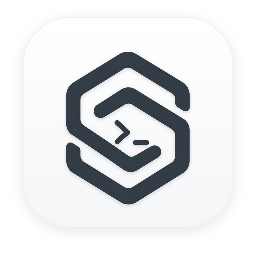
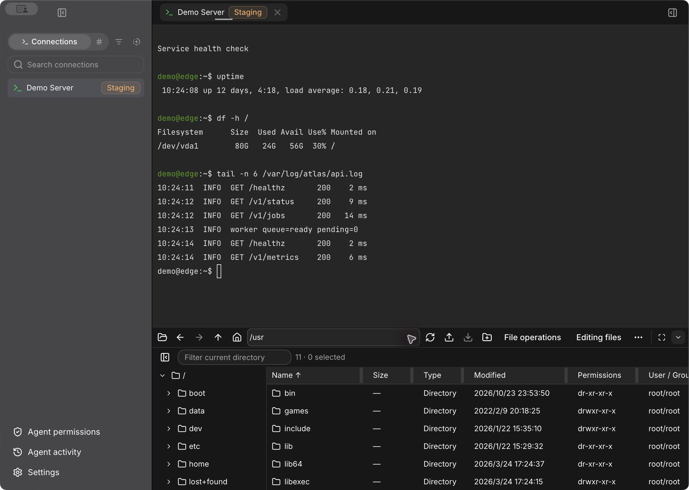

<div align="center">
  
  <h1>VigilShell</h1>
  <p><strong>你和 Agent 的 SSH 工作区。</strong></p>
  <p>连上服务器，开终端、传文件、看监控。需要协助时，通过 MCP 让 Agent 在你授权的连接上查日志、跑命令。它做了什么、返回了什么，都能在 VigilShell 里查看。</p>
  <p>
    <a href="#安装与运行"></a>
    <a href="../LICENSE"></a>
  </p>
  <p><a href="../README.md">English</a> · <strong>简体中文</strong></p>
</div>

<p align="center">
  
  <br />
  <sub>VigilShell Dev 英文界面 · 终端示例输出与远程 /usr 目录</sub>
</p>

## 功能

| 能力         | 当前支持                                                                                                                          |
| ------------ | --------------------------------------------------------------------------------------------------------------------------------- |
| SSH 连接管理 | 密码与私钥认证、连接测试、主机指纹确认；连接分组、环境标记、搜索与排序                                                            |
| 终端工作区   | 多标签会话、终端内容查找、字符编码设置、多行粘贴确认和手动重连                                                                    |
| 代理与隧道   | SOCKS5、HTTP CONNECT 代理；本地转发、远程转发和 SOCKS5 动态转发                                                                   |
| 远程文件     | SFTP 目录浏览、文件与目录上传下载、新建、重命名、删除及权限修改；传输进度、同名冲突处理和失败明细                                 |
| 外部编辑器   | 用本地编辑器打开远程文件，保存后同步回服务器；远端版本变化时提示冲突，并保留待处理的本地修改                                      |
| 服务器监控   | 主机信息、CPU、内存、磁盘与网络流量；监控采样当前面向 Linux 服务器                                                                |
| MCP 与智能体 | 本机 Streamable HTTP 服务、独立接入令牌、按连接配置访问权限；命令、脚本、终端、文件，以及远端环境支持的服务、软件包和系统维护操作 |
| 操作可见性   | 智能体会话视图、任务状态、输出与活动记录；可释放终端控制权或结束智能体会话                                                        |
| 桌面体验     | 简体中文与 English、浅色／深色／跟随系统主题、菜单栏入口和系统通知                                                                |

MCP 操作受连接授权和远端账号权限约束；具体可用能力还取决于服务器环境。VigilShell 提供工具接入，不内置大模型，智能体需由外部 MCP 客户端提供。

## 安装与运行

已发布的安装包可从 [GitHub Releases](https://github.com/sparkwild/vigilshell/releases) 下载，也可以从源码运行或在本地打包。当前原生开发入口与打包脚本针对 macOS。

- **从源码使用**：按照下方[开发](#开发)说明准备环境、配置签名并启动 `VigilShell Dev`。
- **安装本地构建的版本**：完成[本地打包](#本地打包)后，打开 `release/` 中的 DMG，将 `VigilShell.app` 拖入“应用程序”。
- **架构**：打包脚本支持 Apple Silicon（`arm64`）和 Intel（`x64`），每个安装包必须在对应架构的 macOS、Node.js 和 Rust 环境中构建。

当前采用固定证书自签名，未启用 Apple 公证。安装到其他 Mac 时，启动体验取决于该机器的签名信任与系统安全检查；本地成功打包不代表已通过公开分发验证。

## 使用

### 建立 SSH 连接

1. 启动应用，按提示完成系统授权，解锁连接配置。
2. 在侧栏选择“新连接”，填写服务器地址、端口与用户名，选择密码或私钥认证。
3. 如有需要，在连接编辑器中配置终端编码、代理或隧道。
4. 使用“测试连接”验证认证；首次连接或主机密钥变化时，核对服务器指纹后确认信任。
5. 选择“保存并连接”打开终端。已有连接可以在新标签页中再次连接，也可以通过侧栏分组和环境标记整理。

“测试连接”只验证认证，结束后断开，不会打开终端。

### 文件与监控

连接成功后，在终端下方的文件区浏览远程目录，上传、下载或通过右键菜单操作文件。传输列表会显示进度、冲突和失败项；关闭终端时，可以选择让未完成的传输继续在后台运行。

需要编辑远程文本文件时，在“设置 → 文件与传输”选择本地编辑器，再从文件菜单打开文件。编辑器保存后，VigilShell 会尝试同步；遇到远端内容变化时，在“正在编辑”列表中处理冲突或另存本地副本。

右侧工具区的“概览”显示当前服务器信息和监控数据。监控随连接及面板可见状态采样，采样间隔可在“设置 → 服务器监控”调整；远端不支持的指标可能无法显示。

### 接入智能体

1. 打开“设置 → MCP 服务”，启用本地服务并添加连接。可以选择已检测到的客户端，也可以使用“通用智能体”。
2. 选择“让智能体配置”复制接入指令，或复制配置并按客户端要求添加到其 MCP 设置中。客户端需要支持 Streamable HTTP 和 `Authorization` 请求头。
3. 在侧栏的 SSH 连接上右键选择“设置智能体权限”，进入“智能体权限管理”，配置“只读”或“运维”权限，以及所需的路径保护、传输目录和任务限制，再开启访问。
4. 从客户端发起任务，按配置完成会话身份验证。在工作区查看智能体会话，在“设置 → 智能体活动”查看任务和输出。

服务仅监听本机回环地址，默认端口为 `51602`；实际接入地址以设置页显示和复制出的配置为准。复制的配置包含接入令牌，应保存在客户端配置中，不要提交到仓库。

关闭窗口会隐藏应用，MCP 服务仍可运行；通过应用菜单选择“退出 VigilShell”才会完全退出。

## 开发

### 环境要求

| 工具         | 要求                                                                                 |
| ------------ | ------------------------------------------------------------------------------------ |
| 系统         | macOS；原生开发与打包依赖系统签名、钥匙串和原生桥                                    |
| Node.js      | `24.21.0`，见 [.nvmrc](../.nvmrc)                                                    |
| npm          | `11.19.1`，见 [package.json](../package.json)                                        |
| Rust         | `1.96.0`，包含 `rustfmt`、`clippy`，见 [rust-toolchain.toml](../rust-toolchain.toml) |
| 原生编译工具 | Xcode Command Line Tools                                                             |
| 签名身份     | 钥匙串中可用的代码签名证书及对应私钥                                                 |

以下命令假定已安装 Git、nvm、rustup 和 Xcode Command Line Tools，并具备仓库访问权限。

### 获取源码与依赖

```sh
git clone https://github.com/sparkwild/vigilshell.git
cd vigilshell

nvm install
nvm use
npm install --global npm@11.19.1
npm ci

rustup toolchain install 1.96.0 --profile minimal --component rustfmt --component clippy
```

使用仓库中的 `package-lock.json` 和 `Cargo.lock` 安装依赖，完整技术栈见[技术栈](TECH_STACK.md)。

### 配置开发签名

先查看本机可用的代码签名身份：

```sh
security find-identity -v -p codesigning
```

本地开发和自行打包使用开发者自己创建或导入钥匙串的代码签名证书及私钥。配置命令只记录已有身份，不会生成证书，也不支持用临时签名代替固定身份。

将下面的占位内容替换为实际的 **40 位证书指纹**和证书所在钥匙串的**绝对路径**：

```sh
npm run signing:configure -- --profile dev \
  --identity "<DEV_CERTIFICATE_SHA1>" \
  --keychain "<DEV_KEYCHAIN_ABSOLUTE_PATH>"
npm run signing:check -- --profile dev
```

证书导出文件由开发者自行选择源码仓库之外的位置保管。配置脚本按当前用户将所选证书指纹和钥匙串路径分别保存到 `dev`、`release` 目录，实际签名使用该钥匙串中的私钥。已有配置应继续使用原身份。更多约定见[签名准备](TECH_STACK.md#签名准备)。

### 启动开发应用

```sh
npm run dev:app
```

该入口会准备 Rust 后端、通信合同、本地化代码和原生桥，并启动带热更新的 `VigilShell Dev`。日常开发复用同一套签名开发应用；重新运行启动命令或执行完整构建前，先完全退出正在运行的 `VigilShell Dev`。

### 常用命令

| 命令                         | 用途                                                           |
| ---------------------------- | -------------------------------------------------------------- |
| `npm run dev:app`            | 启动签名原生开发应用与热更新                                   |
| `npm run check`              | 依赖、架构边界、lint、格式、类型、合同、本地化及 Rust 静态检查 |
| `npm test`                   | 构建后端，运行签名测试、Vitest 和 Rust 工作区测试              |
| `npm run backend:check`      | 使用锁定依赖执行 Rust 格式、Clippy 和测试检查                  |
| `npm run contracts:generate` | 从 Rust DTO 生成 JSON Schema、TypeScript 类型和运行时验证产物  |
| `npm run contracts:check`    | 检查通信合同生成结果是否与源码一致                             |
| `npm run i18n:generate`      | 从 `messages/` 生成本地化代码                                  |
| `npm run build`              | 编译生产构建所需的后端、原生桥和前端资源                       |
| `npm run package:dev`        | 生成 Dev 应用目录，输出到 `release/dev/`                       |
| `npm run package:release`    | 生成并校验 DMG、更新 ZIP 和元数据，输出到 `release/`               |

通信合同由 Rust DTO 生成，本地化代码由消息源生成；修改对应源码后运行生成命令，不直接编辑生成文件。测试与调试使用 Dev 数据，保留正式应用的数据和签名身份。

### 本地打包

按开发签名的方式，另行准备 `release` 配置。自行分发使用自己管理的身份，同一发行线的后续版本沿用该身份；官方发行使用维护者管理的既有正式身份。选择对应签名身份后执行：

```sh
npm run signing:configure -- --profile release \
  --identity "<RELEASE_CERTIFICATE_SHA1>" \
  --keychain "<RELEASE_KEYCHAIN_ABSOLUTE_PATH>"
npm run signing:check -- --profile release
npm run package:release
```

默认使用当前 Node.js 进程架构。也可以显式指定 `--arch arm64` 或 `--arch x64`，例如在 Apple Silicon 原生环境中运行：

```sh
npm run package:release -- --arch arm64
```

脚本要求目标架构与 macOS 主机进程、Rust 工具链匹配，完成构建、签名以及 DMG、更新 ZIP、校验文件和 `latest-mac.yml` 检查后，才将产物放入 `release/`。该命令仅生成本地文件，不上传安装包或创建 GitHub Release。

`npm run build` 默认使用 release 签名配置。打包构建的前端、原生桥、后端资源与 Cargo 输出位于 `.cache/build/<dev|release>/<架构>/`，与本地热更新产物隔离。release 构建只要求 release 签名配置，不回退到 Dev 凭据。

### ARM64 分发与预览

首期打包面向 Apple Silicon Mac。手动运行 **Preview package** 可以构建临时自签名预览包，并可指定完整提交 SHA。为通过验证的 `main` 提交推送正式版本标签 `vX.Y.Z` 后，工作流使用固定自签名证书构建安装包和更新元数据，并创建 Release 草稿。分发包不经过 Apple 公证。维护者核对草稿后手动发布，GitHub 在发布时锁定标签和附件。

在“设置 → 关于”中手动检查正式版本、下载更新，再选择“重启并安装”。自动检查和自动下载保持关闭；下载完成的更新会跨重启保留，普通退出不会安装。发布页入口继续支持手动下载安装。尚不具备更新引擎的版本，需要先手动升级到包含引擎的版本。

在没有既有 VigilShell 数据的独立测试 Mac／账号中，从同一 Release 下载 DMG 与校验文件，执行 `shasum -a 256 -c <文件>.dmg.sha256`，再拖入“应用程序”。如系统因开发者无法验证而阻止打开，应先核对来源，再使用“隐私与安全性 → 仍要打开”的单应用允许方式，不全局关闭 Gatekeeper。

手动升级先完全退出 VigilShell，再用新版替换应用，验证设置保留、凭据访问及再次启动。首次下载安装、授权提示和 已发布版本之间的升级需要在独立环境实际验收；现有正式数据不参与测试。

## 数据与凭据

连接配置和凭据加密保存在本机，解锁密钥由 macOS Keychain 管理。默认数据目录按应用通道分开：

| 内容                | 默认位置                                            |
| ------------------- | --------------------------------------------------- |
| VigilShell 数据     | `~/Library/Application Support/VigilShell/`         |
| VigilShell Dev 数据 | `~/Library/Application Support/VigilShell-dev/`     |

开发运行可通过 `VIGILSHELL_DATA_DIR` 指定其他绝对路径。源码和构建缓存不等同于用户数据备份；恢复加密配置和凭据还需要匹配的系统密钥。

## 技术与设计

应用采用 Electron Main／Preload、React Renderer 与 Rust Backend 分层。界面通过受控桌面 API 调用后端，通信合同沿 Rust DTO → JSON Schema → TypeScript／Ajv 生成。

| 目录                            | 内容                                       |
| ------------------------------- | ------------------------------------------ |
| `src/renderer/`                 | React 界面与工作区交互                     |
| `src/main/`、`src/preload/`     | Electron 桌面集成、IPC、MCP 与原生能力桥接 |
| `src/contracts/`、`src/shared/` | 桌面合同与共享逻辑                         |
| `crates/`                       | Rust 领域、应用服务、协议与基础设施        |
| `scripts/`、`tests/`            | 开发、构建、检查和测试工具                 |
| `resources/`、`messages/`       | 应用资源、第三方许可与本地化消息           |

- [技术栈](TECH_STACK.md)：依赖版本、工具入口与签名准备。
- [UI 组件与设计规范](UI_DESIGN.md)：组件库、样式令牌与交互约定。
- [系统架构](SYSTEM_ARCHITECTURE.md)：进程、模块职责与状态归属。

## 许可说明

VigilShell 自有代码采用 [Apache-2.0](../LICENSE) 许可。第三方资源许可与声明见 [resources/licenses/](../resources/licenses/)。DMG 和更新 ZIP 在应用旁提供 Electron 自带的完整 `LICENSES.chromium.html`。

[贡献与预览构建](../CONTRIBUTING.md) · [安全政策](SECURITY.md)
